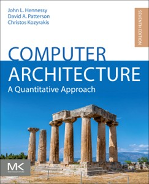
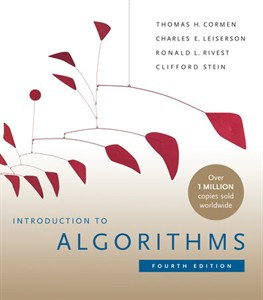

# Learning references

This folder pins study repositories for five textbooks and a digital-design reference that inform work across AI Engineer. Each repository has its own history, scope and license; the root repository records only the selected commit for each reference.

| Cover | Textbook and selected edition | Reference repository | Publisher listing |
| --- | --- | --- | --- |
|  | *Computer Architecture: A Quantitative Approach*<br>Seventh edition (2025); companion covers editions 1–7 | [computer_architecture_a_quantitative_approach](computer_architecture_a_quantitative_approach) | [Elsevier](https://shop.elsevier.com/books/computer-architecture/hennessy/978-0-443-15406-5) |
|  | *Introduction to Algorithms*<br>Fourth edition (2022); companion covers editions 1–4 | [introduction_to_algorithms](introduction_to_algorithms) | [Penguin Random House](https://www.penguinrandomhouse.com/books/704214/introduction-to-algorithms-fourth-edition-by-thomas-h-cormen-charles-e-leiserson-ronald-l-rivest-and-clifford-stein/) |
|  | *Structure and Interpretation of Computer Programs*<br>Second edition (1996); companion also covers the 1984 original and 2022 JavaScript adaptation | [structure_and_interpretation_of_computer_programs](structure_and_interpretation_of_computer_programs) | [MIT Press](https://mitpress.mit.edu/9780262510875/structure-and-interpretation-of-computer-programs/) |
|  | *Compilers: Principles, Techniques, and Tools*<br>Second edition (2006); companion also covers the 1977 predecessor and 1986 first edition | [compilers_principles_techniques_and_tools](compilers_principles_techniques_and_tools) | [Pearson](https://www.pearson.com/en-ca/subject-catalog/p/compilers-principles-techniques-and-tools/P200000003472/9780321486813) |
| — | *Introduction to the Theory of Computation*<br>Three published editions (1997, 2006, 2012/©2013); companion covers editions 1–3 | [introduction_to_the_theory_of_computation](introduction_to_the_theory_of_computation) | [McGraw Hill](https://www.mheducation.com/highered/product/introduction-theory-computation-sipser/M9781133187790.html) |

The companion repositories are independently authored learning materials and implementations; they are not substitutes for the textbooks. Consult each repository's edition guide before relying on a particular edition's organization or coverage. Cover images are shown for identification and review; copyright remains with the respective rights holders.

The [digital_design](digital_design) companion repository provides digital and HDL design reference material.

## Checkout

From the AI Engineer repository root, initialize only these references with:

```sh
git submodule update --init -- learning/computer_architecture_a_quantitative_approach learning/introduction_to_algorithms learning/structure_and_interpretation_of_computer_programs learning/compilers_principles_techniques_and_tools learning/introduction_to_the_theory_of_computation learning/digital_design
```

Or initialize all configured submodules with `git submodule update --init`.

## Reference and rights

When using a textbook to inform an engineering decision or explain a technical claim, cite its exact edition and chapter, section or page where practical. Write original explanations and implementations. The submodule licenses do not automatically grant rights to reproduce the books' text, figures, cover artwork or exercise solutions.
