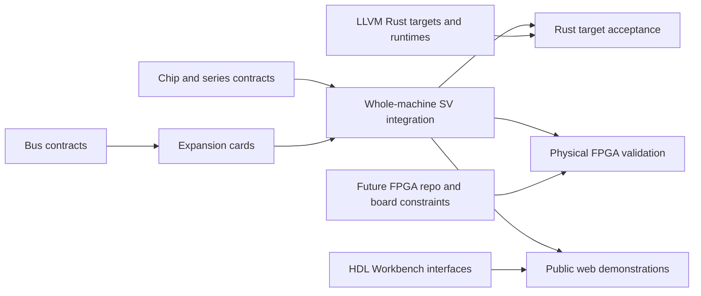

# Initial AI Engineer project plan

Inventory baseline: 2026-10-23 (America/Vancouver). Sources: local ai_hw_engineer design/ and system/ folders, their indices and AMD/MOS ledgers, plus ai_sw_engineer system/README.md. Local work can be newer than the umbrella submodule pins. Space Invaders and unfinished Motorola folders are candidates, not completed designs. Accidental non-ASCII directory names and templates are excluded.

[Board](https://github.com/users/hevangel/projects/1) · [Project manager instructions](project_manager.md)

## First delivery sequence

1. Audit existing MCS-4/Busicom/llvm-i4004 evidence and resolve outstanding review scope.
2. Complete an end-to-end Busicom vertical slice: sourced chips, authentic firmware oracle, SV-backed web frontend, compiled Rust firmware and a separately qualified FPGA target.
3. Advance MCS-8/Micral and 8080/Altair with S-100 cards and exact-ISA compiler feasibility.
4. Integrate Apple II/IIe and IBM PC/XT/Model 30; inventory their cards, firmware and OS/application software.
5. Qualify Atari, C64, NES and SNES in the MOS-ledger acceptance order.

No delivery dates are assigned. Existing implementation is not a reason to skip evidence audit. Native blockers describe complete acceptance, allowing independent subtasks to proceed. FPGA implementation gets per-machine/board issues after the future repository and hardware targets are selected.

## Canonical issues and completion dependencies

| Key | Issue | Kind | Blocked by |
| --- | --- | --- | --- |
| ttl_74_series | [[Chip] 74-series logic](https://github.com/hevangel/ai_engineer/issues/4) | chip | — |
| amd_am2501 (Am25xx series) | [[Chip] AMD Am25xx series](https://github.com/hevangel/ai_engineer/issues/5) | chip | — |
| amd_am29xx | [[Chip] AMD Am29xx series](https://github.com/hevangel/ai_engineer/issues/7) | chip | — |
| amd_am3101 | [[Chip] amd am3101](https://github.com/hevangel/ai_engineer/issues/8) | chip | — |
| amd_am9080 | [[Chip] amd am9080](https://github.com/hevangel/ai_engineer/issues/9) | chip | — |
| amd_am9102 | [[Chip] amd am9102](https://github.com/hevangel/ai_engineer/issues/10) | chip | — |
| amd_am9300 | [[Chip] amd am9300](https://github.com/hevangel/ai_engineer/issues/11) | chip | — |
| amd_am9511 | [[Chip] amd am9511](https://github.com/hevangel/ai_engineer/issues/12) | chip | — |
| amd_am9517 | [[Chip] amd am9517](https://github.com/hevangel/ai_engineer/issues/13) | chip | — |
| apple_iie_iou | [[Chip] apple iie iou](https://github.com/hevangel/ai_engineer/issues/14) | chip | — |
| apple_iie_mmu | [[Chip] apple iie mmu](https://github.com/hevangel/ai_engineer/issues/15) | chip | — |
| apple_iie_pal | [[Chip] apple iie pal](https://github.com/hevangel/ai_engineer/issues/16) | chip | — |
| apple_ii_chips | [[Chip] apple ii chips](https://github.com/hevangel/ai_engineer/issues/17) | chip | — |
| intel_mcs8 | [[Chip] Intel MCS-8 family](https://github.com/hevangel/ai_engineer/issues/18) | chip | — |
| intel_mcs4 | [[Chip] Intel MCS-4 family](https://github.com/hevangel/ai_engineer/issues/19) | chip | — |
| intel_80286 | [[Chip] intel 80286](https://github.com/hevangel/ai_engineer/issues/20) | chip | — |
| intel_8080 | [[Chip] intel 8080](https://github.com/hevangel/ai_engineer/issues/21) | chip | — |
| intel_8086 | [[Chip] intel 8086](https://github.com/hevangel/ai_engineer/issues/22) | chip | — |
| intel_8087 | [[Chip] intel 8087](https://github.com/hevangel/ai_engineer/issues/23) | chip | — |
| intel_8237 | [[Chip] intel 8237](https://github.com/hevangel/ai_engineer/issues/24) | chip | — |
| intel_8251 | [[Chip] intel 8251](https://github.com/hevangel/ai_engineer/issues/25) | chip | — |
| intel_8253_8254 | [[Chip] intel 8253 8254](https://github.com/hevangel/ai_engineer/issues/26) | chip | — |
| intel_8255 | [[Chip] intel 8255](https://github.com/hevangel/ai_engineer/issues/27) | chip | — |
| intel_8259 | [[Chip] intel 8259](https://github.com/hevangel/ai_engineer/issues/28) | chip | — |
| intel_8272 | [[Chip] intel 8272](https://github.com/hevangel/ai_engineer/issues/29) | chip | — |
| intel_8273 | [[Chip] intel 8273](https://github.com/hevangel/ai_engineer/issues/30) | chip | — |
| intel_8275 | [[Chip] intel 8275](https://github.com/hevangel/ai_engineer/issues/31) | chip | — |
| intel_8279 | [[Chip] intel 8279](https://github.com/hevangel/ai_engineer/issues/32) | chip | — |
| mos_6502_family | [[Chip] MOS 6502 CPU family and package variants](https://github.com/hevangel/ai_engineer/issues/33) | chip | — |
| mos_6522 | [[Chip] mos 6522](https://github.com/hevangel/ai_engineer/issues/34) | chip | — |
| mos_6526 | [[Chip] mos 6526](https://github.com/hevangel/ai_engineer/issues/35) | chip | — |
| mos_6530 | [[Chip] mos 6530](https://github.com/hevangel/ai_engineer/issues/36) | chip | — |
| mos_6532 | [[Chip] mos 6532](https://github.com/hevangel/ai_engineer/issues/37) | chip | — |
| mos_6560 | [[Chip] mos 6560](https://github.com/hevangel/ai_engineer/issues/38) | chip | — |
| mos_6567 | [[Chip] mos 6567](https://github.com/hevangel/ai_engineer/issues/42) | chip | — |
| mos_6581 | [[Chip] mos 6581](https://github.com/hevangel/ai_engineer/issues/39) | chip | — |
| mos_7360 | [[Chip] mos 7360](https://github.com/hevangel/ai_engineer/issues/41) | chip | — |
| mos_8520 | [[Chip] mos 8520](https://github.com/hevangel/ai_engineer/issues/40) | chip | — |
| motorola_6800 | [[Chip] motorola 6800](https://github.com/hevangel/ai_engineer/issues/43) | chip | — |
| motorola_68000 | [[Chip] motorola 68000](https://github.com/hevangel/ai_engineer/issues/45) | chip | — |
| motorola_6809 | [[Chip] motorola 6809](https://github.com/hevangel/ai_engineer/issues/46) | chip | — |
| tia | [[Chip] Atari TIA and missing Atari 2600 support devices](https://github.com/hevangel/ai_engineer/issues/44) | chip | — |
| nes_parts | [[Chip] NES/Famicom Ricoh CPU, PPU, APU and cartridge support](https://github.com/hevangel/ai_engineer/issues/48) | chip | [#33](https://github.com/hevangel/ai_engineer/issues/33) |
| snes_parts | [[Chip] Super Nintendo CPU, PPU, audio and support devices](https://github.com/hevangel/ai_engineer/issues/47) | chip | — |
| cards | [[Cards] Establish bus-organized expansion-card reconstruction workflow](https://github.com/hevangel/ai_engineer/issues/49) | cards | — |
| s100 | [[Bus/Cards] S-100 bus](https://github.com/hevangel/ai_engineer/issues/50) | cards | [#49](https://github.com/hevangel/ai_engineer/issues/49) |
| isa | [[Bus/Cards] ISA bus](https://github.com/hevangel/ai_engineer/issues/51) | cards | [#49](https://github.com/hevangel/ai_engineer/issues/49) |
| mca | [[Bus/Cards] IBM PS/2 Micro Channel bus](https://github.com/hevangel/ai_engineer/issues/52) | cards | [#49](https://github.com/hevangel/ai_engineer/issues/49) |
| apple_slots | [[Bus/Cards] Apple II slot bus](https://github.com/hevangel/ai_engineer/issues/54) | cards | [#49](https://github.com/hevangel/ai_engineer/issues/49) |
| fpga | [[FPGA] Establish ai_fpga_engineer and reconstruction handoff](https://github.com/hevangel/ai_engineer/issues/53) | fpga | — |
| card_sio | [[Card] Altair 88-SIO serial interface](https://github.com/hevangel/ai_engineer/issues/105) | cards | [#50](https://github.com/hevangel/ai_engineer/issues/50) |
| crtc6845 | [[Chip] MC6845-compatible CRTC for historical display cards](https://github.com/hevangel/ai_engineer/issues/108) | chip | — |
| card_cga | [[Card] IBM CGA ISA display adapter](https://github.com/hevangel/ai_engineer/issues/107) | cards | [#51](https://github.com/hevangel/ai_engineer/issues/51), [#108](https://github.com/hevangel/ai_engineer/issues/108) |
| card_xtdisk | [[Card] IBM/Xebec XT fixed-disk controller](https://github.com/hevangel/ai_engineer/issues/106) | cards | [#51](https://github.com/hevangel/ai_engineer/issues/51) |
| card_diskii | [[Card] Apple Disk II controller](https://github.com/hevangel/ai_engineer/issues/109) | cards | [#54](https://github.com/hevangel/ai_engineer/issues/54) |
| workbench | [[Tooling] Integrate HDL Workbench with public system demonstrations](https://github.com/hevangel/ai_engineer/issues/55) | tooling | [#112](https://github.com/hevangel/ai_engineer/issues/112) |
| backend_i4004 | [[Toolchain] Rust/LLVM target i4004](https://github.com/hevangel/ai_engineer/issues/3) | toolchain | — |
| backend_i8008 | [[Toolchain] Rust/LLVM target i8008](https://github.com/hevangel/ai_engineer/issues/57) | toolchain | — |
| backend_i8080 | [[Toolchain] Rust/LLVM target i8080](https://github.com/hevangel/ai_engineer/issues/56) | toolchain | — |
| backend_mos6502 | [[Toolchain] Rust/LLVM target mos6502](https://github.com/hevangel/ai_engineer/issues/58) | toolchain | — |
| backend_i8086 | [[Toolchain] Rust/LLVM target i8086](https://github.com/hevangel/ai_engineer/issues/60) | toolchain | — |
| backend_snes | [[Toolchain] Rust/LLVM target snes](https://github.com/hevangel/ai_engineer/issues/59) | toolchain | — |
| backend_m6800 | [[Toolchain] Rust/LLVM target m6800](https://github.com/hevangel/ai_engineer/issues/61) | toolchain | — |
| backend_m6809 | [[Toolchain] Rust/LLVM target m6809](https://github.com/hevangel/ai_engineer/issues/62) | toolchain | — |
| backend_m68k | [[Toolchain] Rust/LLVM target m68k](https://github.com/hevangel/ai_engineer/issues/64) | toolchain | — |
| backend_i286 | [[Toolchain] Rust/LLVM target i286](https://github.com/hevangel/ai_engineer/issues/63) | toolchain | — |
| system_busicom_141pf | [[System] Busicom 141-PF — SV simulation, web frontend and FPGA handoff](https://github.com/hevangel/ai_engineer/issues/65) | system | [#19](https://github.com/hevangel/ai_engineer/issues/19) |
| software_busicom_141pf | [[Software] Busicom 141-PF — Rust firmware, OS and application reconstruction](https://github.com/hevangel/ai_engineer/issues/66) | software | [#3](https://github.com/hevangel/ai_engineer/issues/3), [#65](https://github.com/hevangel/ai_engineer/issues/65) |
| fpga_busicom_141pf | [[FPGA System] Busicom 141-PF — board selection and physical reconstruction](https://github.com/hevangel/ai_engineer/issues/67) | fpga | [#53](https://github.com/hevangel/ai_engineer/issues/53), [#65](https://github.com/hevangel/ai_engineer/issues/65) |
| system_micral_n | [[System] Micral N — SV simulation, web frontend and FPGA handoff](https://github.com/hevangel/ai_engineer/issues/68) | system | [#18](https://github.com/hevangel/ai_engineer/issues/18) |
| software_micral_n | [[Software] Micral N — Rust firmware, OS and application reconstruction](https://github.com/hevangel/ai_engineer/issues/69) | software | [#57](https://github.com/hevangel/ai_engineer/issues/57), [#68](https://github.com/hevangel/ai_engineer/issues/68) |
| fpga_micral_n | [[FPGA System] Micral N — board selection and physical reconstruction](https://github.com/hevangel/ai_engineer/issues/70) | fpga | [#53](https://github.com/hevangel/ai_engineer/issues/53), [#68](https://github.com/hevangel/ai_engineer/issues/68) |
| system_altair_8800 | [[System] MITS Altair 8800 — SV simulation, web frontend and FPGA handoff](https://github.com/hevangel/ai_engineer/issues/71) | system | [#21](https://github.com/hevangel/ai_engineer/issues/21), [#50](https://github.com/hevangel/ai_engineer/issues/50), [#105](https://github.com/hevangel/ai_engineer/issues/105) |
| software_altair_8800 | [[Software] MITS Altair 8800 — Rust firmware, OS and application reconstruction](https://github.com/hevangel/ai_engineer/issues/72) | software | [#56](https://github.com/hevangel/ai_engineer/issues/56), [#71](https://github.com/hevangel/ai_engineer/issues/71) |
| fpga_altair_8800 | [[FPGA System] MITS Altair 8800 — board selection and physical reconstruction](https://github.com/hevangel/ai_engineer/issues/73) | fpga | [#53](https://github.com/hevangel/ai_engineer/issues/53), [#71](https://github.com/hevangel/ai_engineer/issues/71) |
| system_apple_ii | [[System] Apple II revision 0 — SV simulation, web frontend and FPGA handoff](https://github.com/hevangel/ai_engineer/issues/74) | system | [#33](https://github.com/hevangel/ai_engineer/issues/33), [#17](https://github.com/hevangel/ai_engineer/issues/17), [#54](https://github.com/hevangel/ai_engineer/issues/54) |
| software_apple_ii | [[Software] Apple II revision 0 — Rust firmware, OS and application reconstruction](https://github.com/hevangel/ai_engineer/issues/75) | software | [#58](https://github.com/hevangel/ai_engineer/issues/58), [#74](https://github.com/hevangel/ai_engineer/issues/74), [#109](https://github.com/hevangel/ai_engineer/issues/109) |
| fpga_apple_ii | [[FPGA System] Apple II revision 0 — board selection and physical reconstruction](https://github.com/hevangel/ai_engineer/issues/76) | fpga | [#53](https://github.com/hevangel/ai_engineer/issues/53), [#74](https://github.com/hevangel/ai_engineer/issues/74) |
| system_apple_iie | [[System] Apple IIe — SV simulation, web frontend and FPGA handoff](https://github.com/hevangel/ai_engineer/issues/77) | system | [#33](https://github.com/hevangel/ai_engineer/issues/33), [#15](https://github.com/hevangel/ai_engineer/issues/15), [#14](https://github.com/hevangel/ai_engineer/issues/14), [#16](https://github.com/hevangel/ai_engineer/issues/16), [#54](https://github.com/hevangel/ai_engineer/issues/54) |
| software_apple_iie | [[Software] Apple IIe — Rust firmware, OS and application reconstruction](https://github.com/hevangel/ai_engineer/issues/78) | software | [#58](https://github.com/hevangel/ai_engineer/issues/58), [#77](https://github.com/hevangel/ai_engineer/issues/77), [#109](https://github.com/hevangel/ai_engineer/issues/109) |
| fpga_apple_iie | [[FPGA System] Apple IIe — board selection and physical reconstruction](https://github.com/hevangel/ai_engineer/issues/79) | fpga | [#53](https://github.com/hevangel/ai_engineer/issues/53), [#77](https://github.com/hevangel/ai_engineer/issues/77) |
| system_ibm_pc | [[System] IBM PC 5150 — SV simulation, web frontend and FPGA handoff](https://github.com/hevangel/ai_engineer/issues/80) | system | [#22](https://github.com/hevangel/ai_engineer/issues/22), [#24](https://github.com/hevangel/ai_engineer/issues/24), [#26](https://github.com/hevangel/ai_engineer/issues/26), [#27](https://github.com/hevangel/ai_engineer/issues/27), [#28](https://github.com/hevangel/ai_engineer/issues/28), [#29](https://github.com/hevangel/ai_engineer/issues/29), [#51](https://github.com/hevangel/ai_engineer/issues/51), [#107](https://github.com/hevangel/ai_engineer/issues/107) |
| software_ibm_pc | [[Software] IBM PC 5150 — Rust firmware, OS and application reconstruction](https://github.com/hevangel/ai_engineer/issues/81) | software | [#60](https://github.com/hevangel/ai_engineer/issues/60), [#80](https://github.com/hevangel/ai_engineer/issues/80) |
| fpga_ibm_pc | [[FPGA System] IBM PC 5150 — board selection and physical reconstruction](https://github.com/hevangel/ai_engineer/issues/82) | fpga | [#53](https://github.com/hevangel/ai_engineer/issues/53), [#80](https://github.com/hevangel/ai_engineer/issues/80) |
| system_ibm_pc_xt_5160 | [[System] IBM PC XT 5160 — SV simulation, web frontend and FPGA handoff](https://github.com/hevangel/ai_engineer/issues/83) | system | [#22](https://github.com/hevangel/ai_engineer/issues/22), [#23](https://github.com/hevangel/ai_engineer/issues/23), [#51](https://github.com/hevangel/ai_engineer/issues/51), [#107](https://github.com/hevangel/ai_engineer/issues/107), [#106](https://github.com/hevangel/ai_engineer/issues/106) |
| software_ibm_pc_xt_5160 | [[Software] IBM PC XT 5160 — Rust firmware, OS and application reconstruction](https://github.com/hevangel/ai_engineer/issues/84) | software | [#60](https://github.com/hevangel/ai_engineer/issues/60), [#83](https://github.com/hevangel/ai_engineer/issues/83) |
| fpga_ibm_pc_xt_5160 | [[FPGA System] IBM PC XT 5160 — board selection and physical reconstruction](https://github.com/hevangel/ai_engineer/issues/85) | fpga | [#53](https://github.com/hevangel/ai_engineer/issues/53), [#83](https://github.com/hevangel/ai_engineer/issues/83) |
| system_ibm_ps2_model30 | [[System] IBM PS/2 Model 30 — SV simulation, web frontend and FPGA handoff](https://github.com/hevangel/ai_engineer/issues/86) | system | [#22](https://github.com/hevangel/ai_engineer/issues/22), [#24](https://github.com/hevangel/ai_engineer/issues/24), [#26](https://github.com/hevangel/ai_engineer/issues/26), [#28](https://github.com/hevangel/ai_engineer/issues/28), [#29](https://github.com/hevangel/ai_engineer/issues/29), [#51](https://github.com/hevangel/ai_engineer/issues/51) |
| software_ibm_ps2_model30 | [[Software] IBM PS/2 Model 30 — Rust firmware, OS and application reconstruction](https://github.com/hevangel/ai_engineer/issues/87) | software | [#60](https://github.com/hevangel/ai_engineer/issues/60), [#86](https://github.com/hevangel/ai_engineer/issues/86) |
| fpga_ibm_ps2_model30 | [[FPGA System] IBM PS/2 Model 30 — board selection and physical reconstruction](https://github.com/hevangel/ai_engineer/issues/88) | fpga | [#53](https://github.com/hevangel/ai_engineer/issues/53), [#86](https://github.com/hevangel/ai_engineer/issues/86) |
| system_space_invaders | [[System] Space Invaders arcade board — SV simulation, web frontend and FPGA handoff](https://github.com/hevangel/ai_engineer/issues/89) | system | [#21](https://github.com/hevangel/ai_engineer/issues/21) |
| software_space_invaders | [[Software] Space Invaders arcade board — Rust firmware, OS and application reconstruction](https://github.com/hevangel/ai_engineer/issues/90) | software | [#56](https://github.com/hevangel/ai_engineer/issues/56), [#89](https://github.com/hevangel/ai_engineer/issues/89) |
| fpga_space_invaders | [[FPGA System] Space Invaders arcade board — board selection and physical reconstruction](https://github.com/hevangel/ai_engineer/issues/91) | fpga | [#53](https://github.com/hevangel/ai_engineer/issues/53), [#89](https://github.com/hevangel/ai_engineer/issues/89) |
| system_atari_2600 | [[System] Atari 2600 — SV simulation, web frontend and FPGA handoff](https://github.com/hevangel/ai_engineer/issues/92) | system | [#33](https://github.com/hevangel/ai_engineer/issues/33), [#37](https://github.com/hevangel/ai_engineer/issues/37), [#44](https://github.com/hevangel/ai_engineer/issues/44) |
| software_atari_2600 | [[Software] Atari 2600 — Rust firmware, OS and application reconstruction](https://github.com/hevangel/ai_engineer/issues/93) | software | [#58](https://github.com/hevangel/ai_engineer/issues/58), [#92](https://github.com/hevangel/ai_engineer/issues/92) |
| fpga_atari_2600 | [[FPGA System] Atari 2600 — board selection and physical reconstruction](https://github.com/hevangel/ai_engineer/issues/94) | fpga | [#53](https://github.com/hevangel/ai_engineer/issues/53), [#92](https://github.com/hevangel/ai_engineer/issues/92) |
| system_c64 | [[System] Commodore 64 — SV simulation, web frontend and FPGA handoff](https://github.com/hevangel/ai_engineer/issues/95) | system | [#33](https://github.com/hevangel/ai_engineer/issues/33), [#35](https://github.com/hevangel/ai_engineer/issues/35), [#42](https://github.com/hevangel/ai_engineer/issues/42), [#39](https://github.com/hevangel/ai_engineer/issues/39) |
| software_c64 | [[Software] Commodore 64 — Rust firmware, OS and application reconstruction](https://github.com/hevangel/ai_engineer/issues/96) | software | [#58](https://github.com/hevangel/ai_engineer/issues/58), [#95](https://github.com/hevangel/ai_engineer/issues/95) |
| fpga_c64 | [[FPGA System] Commodore 64 — board selection and physical reconstruction](https://github.com/hevangel/ai_engineer/issues/97) | fpga | [#53](https://github.com/hevangel/ai_engineer/issues/53), [#95](https://github.com/hevangel/ai_engineer/issues/95) |
| system_nes | [[System] Nintendo NES/Famicom — SV simulation, web frontend and FPGA handoff](https://github.com/hevangel/ai_engineer/issues/98) | system | [#48](https://github.com/hevangel/ai_engineer/issues/48) |
| software_nes | [[Software] Nintendo NES/Famicom — Rust firmware, OS and application reconstruction](https://github.com/hevangel/ai_engineer/issues/99) | software | [#58](https://github.com/hevangel/ai_engineer/issues/58), [#98](https://github.com/hevangel/ai_engineer/issues/98) |
| fpga_nes | [[FPGA System] Nintendo NES/Famicom — board selection and physical reconstruction](https://github.com/hevangel/ai_engineer/issues/100) | fpga | [#53](https://github.com/hevangel/ai_engineer/issues/53), [#98](https://github.com/hevangel/ai_engineer/issues/98) |
| system_snes | [[System] Super Nintendo — SV simulation, web frontend and FPGA handoff](https://github.com/hevangel/ai_engineer/issues/101) | system | [#47](https://github.com/hevangel/ai_engineer/issues/47) |
| software_snes | [[Software] Super Nintendo — Rust firmware, OS and application reconstruction](https://github.com/hevangel/ai_engineer/issues/102) | software | [#59](https://github.com/hevangel/ai_engineer/issues/59), [#101](https://github.com/hevangel/ai_engineer/issues/101) |
| fpga_snes | [[FPGA System] Super Nintendo — board selection and physical reconstruction](https://github.com/hevangel/ai_engineer/issues/103) | fpga | [#53](https://github.com/hevangel/ai_engineer/issues/53), [#101](https://github.com/hevangel/ai_engineer/issues/101) |
| publication | [[Site] Publish the integrated reconstruction catalog and evidence](https://github.com/hevangel/ai_engineer/issues/104) | site | [#55](https://github.com/hevangel/ai_engineer/issues/55) |
| eda_xezim | [[EDA] Xezim — maintain working simulator integration and qualify upgrades](https://github.com/hevangel/ai_hw_engineer/issues/69) | tooling | — |
| eda_surfer | [[EDA] Surfer — maintain working waveform integration and qualify upgrades](https://github.com/hevangel/ai_hw_engineer/issues/68) | tooling | — |
| eda_workbench | [[EDA] HDL Workbench — sustain the working Xezim and Surfer integration](https://github.com/hevangel/ai_engineer/issues/112) | tooling | [ai_hw_engineer#69](https://github.com/hevangel/ai_hw_engineer/issues/69), [ai_hw_engineer#68](https://github.com/hevangel/ai_hw_engineer/issues/68) |
| intel_80386 | [[Chip] Intel 80386 family — DX and SX](https://github.com/hevangel/ai_engineer/issues/116) | chip | — |
| intel_80287 | [[Chip] Intel 80287 family — numeric coprocessors](https://github.com/hevangel/ai_engineer/issues/113) | chip | — |
| intel_80387 | [[Chip] Intel 80387 family — DX and SX coprocessors](https://github.com/hevangel/ai_engineer/issues/115) | chip | — |
| motorola_68020 | [[Chip] Motorola MC68020](https://github.com/hevangel/ai_engineer/issues/114) | chip | — |
| motorola_68030 | [[Chip] Motorola MC68030](https://github.com/hevangel/ai_engineer/issues/118) | chip | — |
| motorola_68851 | [[Chip] Motorola MC68851 external PMMU](https://github.com/hevangel/ai_engineer/issues/117) | chip | — |
| motorola_6888x | [[Chip] Motorola MC68881 and MC68882 FPU family](https://github.com/hevangel/ai_engineer/issues/119) | chip | — |
| intel_8042 | [[Chip] Intel MCS-48 keyboard/controller devices — 8042 and variants](https://github.com/hevangel/ai_engineer/issues/120) | chip | — |
| rtc146818 | [[Chip] MC146818-compatible RTC and CMOS](https://github.com/hevangel/ai_engineer/issues/121) | chip | — |
| pc_at_glue | [[Platform devices] AT and 386 motherboard chipset inventory](https://github.com/hevangel/ai_engineer/issues/122) | chip | — |
| ym3812 | [[Chip] Yamaha YM3812 OPL2 and associated DAC profile](https://github.com/hevangel/ai_engineer/issues/124) | chip | — |
| ymf262 | [[Chip] Yamaha YMF262 OPL3 and associated DAC profile](https://github.com/hevangel/ai_engineer/issues/123) | chip | — |
| sb_dsp | [[Chip/Controller] Creative Sound Blaster DSP and mixer family](https://github.com/hevangel/ai_engineer/issues/125) | chip | — |
| ega_chip | [[Chipset] IBM EGA display controller and support devices](https://github.com/hevangel/ai_engineer/issues/126) | chip | — |
| vga_chip | [[Chipset] IBM VGA display controller and support devices](https://github.com/hevangel/ai_engineer/issues/127) | chip | — |
| mac_scc | [[Chip] Zilog Z8530 SCC family](https://github.com/hevangel/ai_engineer/issues/128) | chip | — |
| mac_scsi | [[Chip] NCR 5380-compatible SCSI controller](https://github.com/hevangel/ai_engineer/issues/129) | chip | — |
| mac_floppy | [[Chip] Apple IWM and SWIM floppy-controller family](https://github.com/hevangel/ai_engineer/issues/131) | chip | — |
| mac_adb | [[Controller] Macintosh ADB and board-specific control firmware](https://github.com/hevangel/ai_engineer/issues/130) | chip | — |
| mac_glue | [[Platform devices] Classic Macintosh custom logic, audio and IOP inventory](https://github.com/hevangel/ai_engineer/issues/132) | chip | [#34](https://github.com/hevangel/ai_engineer/issues/34) |
| nubus | [[Bus/Cards] Macintosh NuBus expansion](https://github.com/hevangel/ai_engineer/issues/133) | cards | [#49](https://github.com/hevangel/ai_engineer/issues/49) |
| pds | [[Bus/Cards] Macintosh processor-direct expansion slots](https://github.com/hevangel/ai_engineer/issues/135) | cards | [#49](https://github.com/hevangel/ai_engineer/issues/49) |
| card_ega | [[Card] IBM EGA ISA display adapter](https://github.com/hevangel/ai_engineer/issues/134) | cards | [#51](https://github.com/hevangel/ai_engineer/issues/51), [#126](https://github.com/hevangel/ai_engineer/issues/126) |
| card_vga | [[Card] IBM VGA ISA display adapter](https://github.com/hevangel/ai_engineer/issues/136) | cards | [#51](https://github.com/hevangel/ai_engineer/issues/51), [#127](https://github.com/hevangel/ai_engineer/issues/127) |
| card_adlib | [[Card] AdLib Music Synthesizer — original OPL2 ISA card](https://github.com/hevangel/ai_engineer/issues/137) | cards | [#51](https://github.com/hevangel/ai_engineer/issues/51), [#124](https://github.com/hevangel/ai_engineer/issues/124) |
| card_sb | [[Card] Creative Sound Blaster family — 1.x, 2.0, Pro and 16](https://github.com/hevangel/ai_engineer/issues/138) | cards | [#51](https://github.com/hevangel/ai_engineer/issues/51), [#124](https://github.com/hevangel/ai_engineer/issues/124), [#123](https://github.com/hevangel/ai_engineer/issues/123), [#125](https://github.com/hevangel/ai_engineer/issues/125), [#24](https://github.com/hevangel/ai_engineer/issues/24), [#28](https://github.com/hevangel/ai_engineer/issues/28), [#182](https://github.com/hevangel/ai_engineer/issues/182) |
| card_roland_lapc_i | [[Card] Roland LAPC-I — ISA MPU-401 and LA audio reconstruction](https://github.com/hevangel/ai_engineer/issues/183) | cards | [#51](https://github.com/hevangel/ai_engineer/issues/51) |
| card_nubus_video | [[Card] Macintosh II-family NuBus video adapter](https://github.com/hevangel/ai_engineer/issues/139) | cards | [#133](https://github.com/hevangel/ai_engineer/issues/133), [#132](https://github.com/hevangel/ai_engineer/issues/132) |
| backend_i386 | [[Toolchain] Rust/LLVM target original i386](https://github.com/hevangel/ai_engineer/issues/140) | toolchain | [#116](https://github.com/hevangel/ai_engineer/issues/116) |
| audio_rust | [[Software] Rust AdLib, Sound Blaster and Roland drivers and audio regression corpus](https://github.com/hevangel/ai_engineer/issues/141) | software | [#137](https://github.com/hevangel/ai_engineer/issues/137), [#138](https://github.com/hevangel/ai_engineer/issues/138), [#140](https://github.com/hevangel/ai_engineer/issues/140), [#183](https://github.com/hevangel/ai_engineer/issues/183) |
| system_ibm_at_5170 | [[System] IBM PC AT 5170 — SV simulation, web frontend and FPGA handoff](https://github.com/hevangel/ai_engineer/issues/142) | system | [#20](https://github.com/hevangel/ai_engineer/issues/20), [#120](https://github.com/hevangel/ai_engineer/issues/120), [#121](https://github.com/hevangel/ai_engineer/issues/121), [#122](https://github.com/hevangel/ai_engineer/issues/122), [#51](https://github.com/hevangel/ai_engineer/issues/51), [#24](https://github.com/hevangel/ai_engineer/issues/24), [#28](https://github.com/hevangel/ai_engineer/issues/28), [#26](https://github.com/hevangel/ai_engineer/issues/26) |
| software_ibm_at_5170 | [[Software] IBM PC AT 5170 — Rust firmware, OS and applications](https://github.com/hevangel/ai_engineer/issues/143) | software | [#142](https://github.com/hevangel/ai_engineer/issues/142), [#63](https://github.com/hevangel/ai_engineer/issues/63) |
| fpga_ibm_at_5170 | [[FPGA System] IBM PC AT 5170 — board selection and physical reconstruction](https://github.com/hevangel/ai_engineer/issues/144) | fpga | [#53](https://github.com/hevangel/ai_engineer/issues/53), [#142](https://github.com/hevangel/ai_engineer/issues/142) |
| system_deskpro_386 | [[System] Compaq Deskpro 386 — SV simulation, web frontend and FPGA handoff](https://github.com/hevangel/ai_engineer/issues/145) | system | [#116](https://github.com/hevangel/ai_engineer/issues/116), [#122](https://github.com/hevangel/ai_engineer/issues/122), [#51](https://github.com/hevangel/ai_engineer/issues/51), [#120](https://github.com/hevangel/ai_engineer/issues/120), [#121](https://github.com/hevangel/ai_engineer/issues/121) |
| software_deskpro_386 | [[Software] Compaq Deskpro 386 — Rust firmware, OS and applications](https://github.com/hevangel/ai_engineer/issues/146) | software | [#145](https://github.com/hevangel/ai_engineer/issues/145), [#140](https://github.com/hevangel/ai_engineer/issues/140) |
| fpga_deskpro_386 | [[FPGA System] Compaq Deskpro 386 — board selection and physical reconstruction](https://github.com/hevangel/ai_engineer/issues/147) | fpga | [#53](https://github.com/hevangel/ai_engineer/issues/53), [#145](https://github.com/hevangel/ai_engineer/issues/145) |
| system_pc_386sx | [[System] IBM PS/2 Model 25 SX — SV simulation, web frontend and FPGA handoff](https://github.com/hevangel/ai_engineer/issues/148) | system | [#116](https://github.com/hevangel/ai_engineer/issues/116), [#122](https://github.com/hevangel/ai_engineer/issues/122), [#51](https://github.com/hevangel/ai_engineer/issues/51), [#120](https://github.com/hevangel/ai_engineer/issues/120), [#121](https://github.com/hevangel/ai_engineer/issues/121) |
| software_pc_386sx | [[Software] IBM PS/2 Model 25 SX — Rust firmware, OS and applications](https://github.com/hevangel/ai_engineer/issues/150) | software | [#148](https://github.com/hevangel/ai_engineer/issues/148), [#140](https://github.com/hevangel/ai_engineer/issues/140) |
| fpga_pc_386sx | [[FPGA System] IBM PS/2 Model 25 SX — board selection and physical reconstruction](https://github.com/hevangel/ai_engineer/issues/149) | fpga | [#53](https://github.com/hevangel/ai_engineer/issues/53), [#148](https://github.com/hevangel/ai_engineer/issues/148) |
| system_ps2_model80 | [[System] IBM PS/2 Model 80 — SV simulation, web frontend and FPGA handoff](https://github.com/hevangel/ai_engineer/issues/151) | system | [#116](https://github.com/hevangel/ai_engineer/issues/116), [#122](https://github.com/hevangel/ai_engineer/issues/122), [#52](https://github.com/hevangel/ai_engineer/issues/52), [#127](https://github.com/hevangel/ai_engineer/issues/127) |
| software_ps2_model80 | [[Software] IBM PS/2 Model 80 — Rust firmware, OS and applications](https://github.com/hevangel/ai_engineer/issues/152) | software | [#151](https://github.com/hevangel/ai_engineer/issues/151), [#140](https://github.com/hevangel/ai_engineer/issues/140) |
| fpga_ps2_model80 | [[FPGA System] IBM PS/2 Model 80 — board selection and physical reconstruction](https://github.com/hevangel/ai_engineer/issues/154) | fpga | [#53](https://github.com/hevangel/ai_engineer/issues/53), [#151](https://github.com/hevangel/ai_engineer/issues/151) |
| system_mac_128k | [[System] Macintosh 128K — SV simulation, web frontend and FPGA handoff](https://github.com/hevangel/ai_engineer/issues/153) | system | [#45](https://github.com/hevangel/ai_engineer/issues/45), [#128](https://github.com/hevangel/ai_engineer/issues/128), [#131](https://github.com/hevangel/ai_engineer/issues/131), [#132](https://github.com/hevangel/ai_engineer/issues/132) |
| software_mac_128k | [[Software] Macintosh 128K — Rust firmware, OS and applications](https://github.com/hevangel/ai_engineer/issues/155) | software | [#153](https://github.com/hevangel/ai_engineer/issues/153), [#64](https://github.com/hevangel/ai_engineer/issues/64) |
| fpga_mac_128k | [[FPGA System] Macintosh 128K — board selection and physical reconstruction](https://github.com/hevangel/ai_engineer/issues/156) | fpga | [#53](https://github.com/hevangel/ai_engineer/issues/53), [#153](https://github.com/hevangel/ai_engineer/issues/153) |
| system_mac_512k | [[System] Macintosh 512K — SV simulation, web frontend and FPGA handoff](https://github.com/hevangel/ai_engineer/issues/158) | system | [#45](https://github.com/hevangel/ai_engineer/issues/45), [#128](https://github.com/hevangel/ai_engineer/issues/128), [#131](https://github.com/hevangel/ai_engineer/issues/131), [#132](https://github.com/hevangel/ai_engineer/issues/132) |
| software_mac_512k | [[Software] Macintosh 512K — Rust firmware, OS and applications](https://github.com/hevangel/ai_engineer/issues/157) | software | [#158](https://github.com/hevangel/ai_engineer/issues/158), [#64](https://github.com/hevangel/ai_engineer/issues/64) |
| fpga_mac_512k | [[FPGA System] Macintosh 512K — board selection and physical reconstruction](https://github.com/hevangel/ai_engineer/issues/159) | fpga | [#53](https://github.com/hevangel/ai_engineer/issues/53), [#158](https://github.com/hevangel/ai_engineer/issues/158) |
| system_mac_plus | [[System] Macintosh Plus — SV simulation, web frontend and FPGA handoff](https://github.com/hevangel/ai_engineer/issues/160) | system | [#45](https://github.com/hevangel/ai_engineer/issues/45), [#128](https://github.com/hevangel/ai_engineer/issues/128), [#131](https://github.com/hevangel/ai_engineer/issues/131), [#129](https://github.com/hevangel/ai_engineer/issues/129), [#132](https://github.com/hevangel/ai_engineer/issues/132) |
| software_mac_plus | [[Software] Macintosh Plus — Rust firmware, OS and applications](https://github.com/hevangel/ai_engineer/issues/161) | software | [#160](https://github.com/hevangel/ai_engineer/issues/160), [#64](https://github.com/hevangel/ai_engineer/issues/64) |
| fpga_mac_plus | [[FPGA System] Macintosh Plus — board selection and physical reconstruction](https://github.com/hevangel/ai_engineer/issues/162) | fpga | [#53](https://github.com/hevangel/ai_engineer/issues/53), [#160](https://github.com/hevangel/ai_engineer/issues/160) |
| system_mac_se | [[System] Macintosh SE — SV simulation, web frontend and FPGA handoff](https://github.com/hevangel/ai_engineer/issues/163) | system | [#45](https://github.com/hevangel/ai_engineer/issues/45), [#128](https://github.com/hevangel/ai_engineer/issues/128), [#131](https://github.com/hevangel/ai_engineer/issues/131), [#129](https://github.com/hevangel/ai_engineer/issues/129), [#130](https://github.com/hevangel/ai_engineer/issues/130), [#132](https://github.com/hevangel/ai_engineer/issues/132), [#135](https://github.com/hevangel/ai_engineer/issues/135) |
| software_mac_se | [[Software] Macintosh SE — Rust firmware, OS and applications](https://github.com/hevangel/ai_engineer/issues/164) | software | [#163](https://github.com/hevangel/ai_engineer/issues/163), [#64](https://github.com/hevangel/ai_engineer/issues/64) |
| fpga_mac_se | [[FPGA System] Macintosh SE — board selection and physical reconstruction](https://github.com/hevangel/ai_engineer/issues/165) | fpga | [#53](https://github.com/hevangel/ai_engineer/issues/53), [#163](https://github.com/hevangel/ai_engineer/issues/163) |
| system_mac_ii | [[System] Macintosh II — SV simulation, web frontend and FPGA handoff](https://github.com/hevangel/ai_engineer/issues/167) | system | [#114](https://github.com/hevangel/ai_engineer/issues/114), [#119](https://github.com/hevangel/ai_engineer/issues/119), [#128](https://github.com/hevangel/ai_engineer/issues/128), [#131](https://github.com/hevangel/ai_engineer/issues/131), [#129](https://github.com/hevangel/ai_engineer/issues/129), [#130](https://github.com/hevangel/ai_engineer/issues/130), [#132](https://github.com/hevangel/ai_engineer/issues/132), [#139](https://github.com/hevangel/ai_engineer/issues/139) |
| software_mac_ii | [[Software] Macintosh II — Rust firmware, OS and applications](https://github.com/hevangel/ai_engineer/issues/166) | software | [#167](https://github.com/hevangel/ai_engineer/issues/167), [#64](https://github.com/hevangel/ai_engineer/issues/64) |
| fpga_mac_ii | [[FPGA System] Macintosh II — board selection and physical reconstruction](https://github.com/hevangel/ai_engineer/issues/168) | fpga | [#53](https://github.com/hevangel/ai_engineer/issues/53), [#167](https://github.com/hevangel/ai_engineer/issues/167) |
| system_mac_iix | [[System] Macintosh IIx — SV simulation, web frontend and FPGA handoff](https://github.com/hevangel/ai_engineer/issues/169) | system | [#118](https://github.com/hevangel/ai_engineer/issues/118), [#119](https://github.com/hevangel/ai_engineer/issues/119), [#128](https://github.com/hevangel/ai_engineer/issues/128), [#131](https://github.com/hevangel/ai_engineer/issues/131), [#129](https://github.com/hevangel/ai_engineer/issues/129), [#130](https://github.com/hevangel/ai_engineer/issues/130), [#132](https://github.com/hevangel/ai_engineer/issues/132), [#139](https://github.com/hevangel/ai_engineer/issues/139) |
| software_mac_iix | [[Software] Macintosh IIx — Rust firmware, OS and applications](https://github.com/hevangel/ai_engineer/issues/170) | software | [#169](https://github.com/hevangel/ai_engineer/issues/169), [#64](https://github.com/hevangel/ai_engineer/issues/64) |
| fpga_mac_iix | [[FPGA System] Macintosh IIx — board selection and physical reconstruction](https://github.com/hevangel/ai_engineer/issues/171) | fpga | [#53](https://github.com/hevangel/ai_engineer/issues/53), [#169](https://github.com/hevangel/ai_engineer/issues/169) |
| system_mac_se30 | [[System] Macintosh SE/30 — SV simulation, web frontend and FPGA handoff](https://github.com/hevangel/ai_engineer/issues/172) | system | [#118](https://github.com/hevangel/ai_engineer/issues/118), [#119](https://github.com/hevangel/ai_engineer/issues/119), [#128](https://github.com/hevangel/ai_engineer/issues/128), [#131](https://github.com/hevangel/ai_engineer/issues/131), [#129](https://github.com/hevangel/ai_engineer/issues/129), [#130](https://github.com/hevangel/ai_engineer/issues/130), [#132](https://github.com/hevangel/ai_engineer/issues/132), [#135](https://github.com/hevangel/ai_engineer/issues/135) |
| software_mac_se30 | [[Software] Macintosh SE/30 — Rust firmware, OS and applications](https://github.com/hevangel/ai_engineer/issues/173) | software | [#172](https://github.com/hevangel/ai_engineer/issues/172), [#64](https://github.com/hevangel/ai_engineer/issues/64) |
| fpga_mac_se30 | [[FPGA System] Macintosh SE/30 — board selection and physical reconstruction](https://github.com/hevangel/ai_engineer/issues/174) | fpga | [#53](https://github.com/hevangel/ai_engineer/issues/53), [#172](https://github.com/hevangel/ai_engineer/issues/172) |
| system_mac_iici | [[System] Macintosh IIci — SV simulation, web frontend and FPGA handoff](https://github.com/hevangel/ai_engineer/issues/175) | system | [#118](https://github.com/hevangel/ai_engineer/issues/118), [#119](https://github.com/hevangel/ai_engineer/issues/119), [#128](https://github.com/hevangel/ai_engineer/issues/128), [#131](https://github.com/hevangel/ai_engineer/issues/131), [#129](https://github.com/hevangel/ai_engineer/issues/129), [#130](https://github.com/hevangel/ai_engineer/issues/130), [#132](https://github.com/hevangel/ai_engineer/issues/132), [#133](https://github.com/hevangel/ai_engineer/issues/133) |
| software_mac_iici | [[Software] Macintosh IIci — Rust firmware, OS and applications](https://github.com/hevangel/ai_engineer/issues/176) | software | [#175](https://github.com/hevangel/ai_engineer/issues/175), [#64](https://github.com/hevangel/ai_engineer/issues/64) |
| fpga_mac_iici | [[FPGA System] Macintosh IIci — board selection and physical reconstruction](https://github.com/hevangel/ai_engineer/issues/177) | fpga | [#53](https://github.com/hevangel/ai_engineer/issues/53), [#175](https://github.com/hevangel/ai_engineer/issues/175) |
| system_mac_iifx | [[System] Macintosh IIfx — SV simulation, web frontend and FPGA handoff](https://github.com/hevangel/ai_engineer/issues/179) | system | [#118](https://github.com/hevangel/ai_engineer/issues/118), [#119](https://github.com/hevangel/ai_engineer/issues/119), [#128](https://github.com/hevangel/ai_engineer/issues/128), [#131](https://github.com/hevangel/ai_engineer/issues/131), [#129](https://github.com/hevangel/ai_engineer/issues/129), [#130](https://github.com/hevangel/ai_engineer/issues/130), [#132](https://github.com/hevangel/ai_engineer/issues/132), [#139](https://github.com/hevangel/ai_engineer/issues/139) |
| software_mac_iifx | [[Software] Macintosh IIfx — Rust firmware, OS and applications](https://github.com/hevangel/ai_engineer/issues/178) | software | [#179](https://github.com/hevangel/ai_engineer/issues/179), [#64](https://github.com/hevangel/ai_engineer/issues/64) |
| fpga_mac_iifx | [[FPGA System] Macintosh IIfx — board selection and physical reconstruction](https://github.com/hevangel/ai_engineer/issues/180) | fpga | [#53](https://github.com/hevangel/ai_engineer/issues/53), [#179](https://github.com/hevangel/ai_engineer/issues/179) |
| coverage_386 | [[Program] Complete-stack coverage through 386 and 68030 Macintosh](https://github.com/hevangel/ai_engineer/issues/181) | system | [#142](https://github.com/hevangel/ai_engineer/issues/142), [#143](https://github.com/hevangel/ai_engineer/issues/143), [#144](https://github.com/hevangel/ai_engineer/issues/144), [#145](https://github.com/hevangel/ai_engineer/issues/145), [#146](https://github.com/hevangel/ai_engineer/issues/146), [#147](https://github.com/hevangel/ai_engineer/issues/147), [#148](https://github.com/hevangel/ai_engineer/issues/148), [#150](https://github.com/hevangel/ai_engineer/issues/150), [#149](https://github.com/hevangel/ai_engineer/issues/149), [#151](https://github.com/hevangel/ai_engineer/issues/151), [#152](https://github.com/hevangel/ai_engineer/issues/152), [#154](https://github.com/hevangel/ai_engineer/issues/154), [#153](https://github.com/hevangel/ai_engineer/issues/153), [#155](https://github.com/hevangel/ai_engineer/issues/155), [#156](https://github.com/hevangel/ai_engineer/issues/156), [#158](https://github.com/hevangel/ai_engineer/issues/158), [#157](https://github.com/hevangel/ai_engineer/issues/157), [#159](https://github.com/hevangel/ai_engineer/issues/159), [#160](https://github.com/hevangel/ai_engineer/issues/160), [#161](https://github.com/hevangel/ai_engineer/issues/161), [#162](https://github.com/hevangel/ai_engineer/issues/162), [#163](https://github.com/hevangel/ai_engineer/issues/163), [#164](https://github.com/hevangel/ai_engineer/issues/164), [#165](https://github.com/hevangel/ai_engineer/issues/165), [#167](https://github.com/hevangel/ai_engineer/issues/167), [#166](https://github.com/hevangel/ai_engineer/issues/166), [#168](https://github.com/hevangel/ai_engineer/issues/168), [#169](https://github.com/hevangel/ai_engineer/issues/169), [#170](https://github.com/hevangel/ai_engineer/issues/170), [#171](https://github.com/hevangel/ai_engineer/issues/171), [#172](https://github.com/hevangel/ai_engineer/issues/172), [#173](https://github.com/hevangel/ai_engineer/issues/173), [#174](https://github.com/hevangel/ai_engineer/issues/174), [#175](https://github.com/hevangel/ai_engineer/issues/175), [#176](https://github.com/hevangel/ai_engineer/issues/176), [#177](https://github.com/hevangel/ai_engineer/issues/177), [#179](https://github.com/hevangel/ai_engineer/issues/179), [#178](https://github.com/hevangel/ai_engineer/issues/178), [#180](https://github.com/hevangel/ai_engineer/issues/180), [#137](https://github.com/hevangel/ai_engineer/issues/137), [#138](https://github.com/hevangel/ai_engineer/issues/138), [#141](https://github.com/hevangel/ai_engineer/issues/141), [#113](https://github.com/hevangel/ai_engineer/issues/113), [#115](https://github.com/hevangel/ai_engineer/issues/115), [#117](https://github.com/hevangel/ai_engineer/issues/117), [#134](https://github.com/hevangel/ai_engineer/issues/134), [#136](https://github.com/hevangel/ai_engineer/issues/136) |
| saa1099 | [[Chip] Philips SAA1099 family — CMS and early Sound Blaster audio](https://github.com/hevangel/ai_engineer/issues/182) | chip | — |

## Existing board items

Reuse ai_engineer#3 for llvm-i4004. Existing #1 and #2 have ambiguous duplicate llm-4004 titles; preserve them for owner triage. Existing ai_hw_engineer#57 remains linked to its original review evidence; do not assume the historical findings still describe current RTL. The roadmap starts in Todo pending acceptance review.

## Scope expansion

Bus umbrella issues are not individual completed cards. Each needs a sourced card catalog and per-card children. Software umbrella issues require a per-title catalog of firmware, boot code, OS where applicable, languages, utilities and applications; the candidate list is not exhaustive. Missing CPU, graphics, audio, mapper, drive and support chips discovered from schematics get explicit issues before system sign-off. Series trackers retain one issue for the full family and grow their member checklist. No nonexistent FPGA repository or unimplemented system is represented as delivered.

## Dependency overview

The table and native GitHub blocked-by links are the detailed graph. This diagram summarizes acceptance flow; it does not require unrelated chips or cards to block every system.

## EDA tools track

[EDA tool specifications](eda_tools.md) record the working HDL Workbench baseline, Xezim and Surfer source pins, qualification scope, and native dependencies into public-system integration.

## 386 and Macintosh expansion

The [386/68030 scope](era_386_scope.md) extends CPU, system, card, compiler, software and FPGA coverage, including AdLib and Sound Blaster. This expands the initial delivery sequence; it does not declare later machines implemented.

## PDP-1, selected IBM 386 systems and AMD x86 extension

The owner added the [PDP-1 Am29xx implementation](pdp1_am29xx.md) and [IBM/AMD 386 profiles](ibm_386_amd_scope.md). Model 25 SX replaces the prior Compaq SX selection while keeping #148/#149/#150. The new tracks remain Todo; no implementation or verification is implied.

| Key | Issue | Kind | Blocked by |
| --- | --- | --- | --- |
| `system_pdp1` | [[System] DEC PDP-1 — Am29xx bit-slice SV reconstruction and web front panel](https://github.com/hevangel/ai_engineer/issues/184) | system | [#7](https://github.com/hevangel/ai_engineer/issues/7) |
| `toolchain_pdp1` | [[Toolchain] PDP-1 18-bit ISA — Rust/LLVM feasibility and target plan](https://github.com/hevangel/ai_engineer/issues/185) | toolchain | — |
| `software_pdp1` | [[Software] DEC PDP-1 — Rust tools, Spacewar! and historical software reconstruction](https://github.com/hevangel/ai_engineer/issues/186) | software | [#184](https://github.com/hevangel/ai_engineer/issues/184), [#185](https://github.com/hevangel/ai_engineer/issues/185) |
| `fpga_pdp1` | [[FPGA System] DEC PDP-1 — Am29xx RTL physical implementation](https://github.com/hevangel/ai_engineer/issues/187) | fpga | [#53](https://github.com/hevangel/ai_engineer/issues/53), [#184](https://github.com/hevangel/ai_engineer/issues/184) |

The IBM/AMD table includes the retained Model 25 SX issue identities and all new canonical tracks.

| Key | Issue | Workstream | Blocked by |
| --- | --- | --- | --- |
| `ibm_386slc` | [[Chip] IBM 386SLC — cached 386SX-derived processor](https://github.com/hevangel/ai_engineer/issues/188) | Chips | [#116](https://github.com/hevangel/ai_engineer/issues/116) |
| `amd_8086_family` | [[Chip] AMD 8086 and 8088 family — licensed x86 implementations](https://github.com/hevangel/ai_engineer/issues/189) | Chips | — |
| `amd_80186_family` | [[Chip] AMD 80186 and 80188 family — integrated x86 processors](https://github.com/hevangel/ai_engineer/issues/190) | Chips | — |
| `amd_80286` | [[Chip] AMD 80286 / Am286 family — protected-mode x86](https://github.com/hevangel/ai_engineer/issues/191) | Chips | — |
| `amd_am386` | [[Chip] AMD Am386 family — DX, SX and low-power variants](https://github.com/hevangel/ai_engineer/issues/192) | Chips | — |
| `system_pc_386sx` | [[System] IBM PS/2 Model 25 SX — SV simulation, web frontend and FPGA handoff](https://github.com/hevangel/ai_engineer/issues/148) | Systems | [#116](https://github.com/hevangel/ai_engineer/issues/116), [#122](https://github.com/hevangel/ai_engineer/issues/122), [#51](https://github.com/hevangel/ai_engineer/issues/51), [#127](https://github.com/hevangel/ai_engineer/issues/127), [#121](https://github.com/hevangel/ai_engineer/issues/121) |
| `software_pc_386sx` | [[Software] IBM PS/2 Model 25 SX — Rust firmware, OS, drivers and applications](https://github.com/hevangel/ai_engineer/issues/150) | Software | [#148](https://github.com/hevangel/ai_engineer/issues/148), [#140](https://github.com/hevangel/ai_engineer/issues/140) |
| `fpga_pc_386sx` | [[FPGA System] IBM PS/2 Model 25 SX — board selection and physical reconstruction](https://github.com/hevangel/ai_engineer/issues/149) | FPGA | [#53](https://github.com/hevangel/ai_engineer/issues/53), [#148](https://github.com/hevangel/ai_engineer/issues/148) |
| `system_ps2_model35sx` | [[System] IBM PS/2 Model 35 SX — SV simulation, web frontend and FPGA handoff](https://github.com/hevangel/ai_engineer/issues/193) | Systems | [#116](https://github.com/hevangel/ai_engineer/issues/116), [#122](https://github.com/hevangel/ai_engineer/issues/122), [#51](https://github.com/hevangel/ai_engineer/issues/51), [#127](https://github.com/hevangel/ai_engineer/issues/127), [#121](https://github.com/hevangel/ai_engineer/issues/121) |
| `software_ps2_model35sx` | [[Software] IBM PS/2 Model 35 SX — Rust firmware, OS, drivers and applications](https://github.com/hevangel/ai_engineer/issues/194) | Software | [#193](https://github.com/hevangel/ai_engineer/issues/193), [#140](https://github.com/hevangel/ai_engineer/issues/140) |
| `fpga_ps2_model35sx` | [[FPGA System] IBM PS/2 Model 35 SX — board selection and physical reconstruction](https://github.com/hevangel/ai_engineer/issues/195) | FPGA | [#53](https://github.com/hevangel/ai_engineer/issues/53), [#193](https://github.com/hevangel/ai_engineer/issues/193) |
| `system_ps2_model70` | [[System] IBM PS/2 Model 70 386 — SV simulation, web frontend and FPGA handoff](https://github.com/hevangel/ai_engineer/issues/196) | Systems | [#116](https://github.com/hevangel/ai_engineer/issues/116), [#122](https://github.com/hevangel/ai_engineer/issues/122), [#52](https://github.com/hevangel/ai_engineer/issues/52), [#127](https://github.com/hevangel/ai_engineer/issues/127), [#121](https://github.com/hevangel/ai_engineer/issues/121) |
| `software_ps2_model70` | [[Software] IBM PS/2 Model 70 386 — Rust firmware, OS, drivers and applications](https://github.com/hevangel/ai_engineer/issues/197) | Software | [#196](https://github.com/hevangel/ai_engineer/issues/196), [#140](https://github.com/hevangel/ai_engineer/issues/140) |
| `fpga_ps2_model70` | [[FPGA System] IBM PS/2 Model 70 386 — board selection and physical reconstruction](https://github.com/hevangel/ai_engineer/issues/198) | FPGA | [#53](https://github.com/hevangel/ai_engineer/issues/53), [#196](https://github.com/hevangel/ai_engineer/issues/196) |
| `system_ps2_model56slc` | [[System] IBM PS/2 Model 56 SLC — SV simulation, web frontend and FPGA handoff](https://github.com/hevangel/ai_engineer/issues/199) | Systems | [#188](https://github.com/hevangel/ai_engineer/issues/188), [#122](https://github.com/hevangel/ai_engineer/issues/122), [#52](https://github.com/hevangel/ai_engineer/issues/52), [#127](https://github.com/hevangel/ai_engineer/issues/127), [#121](https://github.com/hevangel/ai_engineer/issues/121) |
| `software_ps2_model56slc` | [[Software] IBM PS/2 Model 56 SLC — Rust firmware, OS, drivers and applications](https://github.com/hevangel/ai_engineer/issues/200) | Software | [#199](https://github.com/hevangel/ai_engineer/issues/199), [#140](https://github.com/hevangel/ai_engineer/issues/140) |
| `fpga_ps2_model56slc` | [[FPGA System] IBM PS/2 Model 56 SLC — board selection and physical reconstruction](https://github.com/hevangel/ai_engineer/issues/201) | FPGA | [#53](https://github.com/hevangel/ai_engineer/issues/53), [#199](https://github.com/hevangel/ai_engineer/issues/199) |

## Intel numeric coprocessors

[287 and 387 profiles](coprocessors_287_387.md) retain canonical #113/#115, distinguish 387DX/SX history and host interfaces, and record optional machine configurations without adding base-machine blockers. The 387SX has a separate photograph and a November 1988 manufacturer-document bound.

## Coherent motherboard chipset families

- [[Chipset] Intel 82230 / 82231 AT-compatible support chipset](https://github.com/hevangel/ai_engineer/issues/203): 82230, 82231; Todo / Chips, one public card.
- [[Chipset] CHIPS NEAT CS8221 — 82C211 / 82C212 / 82C215 / 82C206](https://github.com/hevangel/ai_engineer/issues/204): 82C211, 82C212, 82C215, 82C206; Todo / Chips, one public card.

See [chipsets.md](chipsets.md). No factory-board links are inferred from AT compatibility.

## Am25xx series consolidation

Issue #5 is the sole active Am25xx series tracker and maps to one timeline card with Am2501 and Am2505 member records. Former issue [#6](https://github.com/hevangel/ai_engineer/issues/6) is closed as superseded (not implemented) and its project item is archived. Neither issue had native blocked-by or blocking edges to transfer. The stable catalog ID `amd_am2501` is retained; its public title is AMD Am25xx series, and its earliest documented member anchors the card to 1970. Am2505 retains its documented-by-1971 qualification in the member ledger.

## Compatible and optional configuration follow-up

The complete qualification tracker inventory is maintained in [data/option-issues.json](../data/option-issues.json). There is one tracker for each curated compatible CPU profile and each optional card/coprocessor–host pair. Original CPU issues block CPU-alternative qualification; computer issues block optional configuration acceptance. Existing canonical chip/card issues remain the implementation inventory. Run the read-only `sync-option-issues.mjs` check to compare this inventory with native GitHub blockers and project membership.

## SCELBI 8B roadmap addition

The approximately 1975 16 KiB 8008 SCELBI 8B is distinct from the 1974 8H. https://github.com/simh/simh/blob/master/Intel-Systems/scelbi/scelbi.txt describes the selected profile.

- system: https://github.com/hevangel/ai_hw_engineer/issues/86
- software: https://github.com/hevangel/ai_engineer/issues/343
- emulator: https://github.com/hevangel/ai_sw_engineer/issues/118
- compiler: https://github.com/hevangel/ai_sw_engineer/issues/119
- frontend: https://github.com/hevangel/ai_sw_engineer/issues/120
- fpga: https://github.com/hevangel/ai_engineer/issues/344

Existing SV work is unmerged in hardware PR #65 at commit `49c1bf6e7e4f4b423b26bd14ec20b0147428e09e`, path `ai_hw_engineer/system/scelbi_8b`. System status Building reflects partial implementation, not complete verification. Historical reports were inspected, not rerun. LET hangs, missing waveform/screenshots, paper tape and supplements remain explicit. Other tracks are Planned. Software depends on the compiler profile; existing emulators may be used without waiting for the Rust emulator/frontend. The frontend defaults to Rust/WASM with optional Xezim SV signal inspection. No exact licensed photograph was selected; the timeline uses Photo needed.
