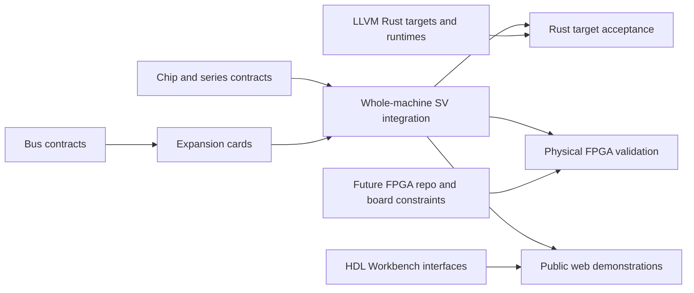

# Initial AI Engineer project plan

Inventory baseline: 2026-10-23 (America/Vancouver). Sources: local ai_hw_engineer design/ and system/ folders, their indices and AMD/MOS ledgers, plus ai_sw_engineer system/README.md. Local work can be newer than the umbrella submodule pins. Space Invaders and unfinished Motorola folders are candidates, not completed designs. Accidental non-ASCII directory names and templates are excluded.

[Board](https://github.com/users/hevangel/projects/1) · [Project manager instructions](project_manager.md)

## First delivery sequence

1. Audit existing MCS-4/Busicom/llvm-i4004 evidence and resolve outstanding review scope.
2. Complete an end-to-end Busicom vertical slice: sourced chips, authentic firmware oracle, SV-backed web frontend, compiled Rust firmware and a separately qualified FPGA target.
3. Advance MCS-8/Micral and 8080/Altair with S-100 cards and exact-ISA compiler feasibility.
4. Integrate Apple II/IIe and IBM PC/XT/Model 30; inventory their cards, firmware and OS/application software.
5. Qualify Atari, C64, NES and SNES in the MOS-ledger acceptance order.

No delivery dates are assigned. Existing implementation is not a reason to skip evidence audit. Native blockers describe complete acceptance, allowing independent subtasks to proceed. FPGA implementation gets per-machine/board issues after the future repository and hardware targets are selected.

## Canonical issues and completion dependencies

| Key | Issue | Kind | Blocked by |
| --- | --- | --- | --- |
| ttl_74_series | [[Chip] 74-series logic](https://github.com/hevangel/ai_engineer/issues/4) | chip | — |
| amd_am2501 | [[Chip] amd am2501](https://github.com/hevangel/ai_engineer/issues/5) | chip | — |
| amd_am2505 | [[Chip] amd am2505](https://github.com/hevangel/ai_engineer/issues/6) | chip | — |
| amd_am29xx | [[Chip] AMD Am29xx series](https://github.com/hevangel/ai_engineer/issues/7) | chip | — |
| amd_am3101 | [[Chip] amd am3101](https://github.com/hevangel/ai_engineer/issues/8) | chip | — |
| amd_am9080 | [[Chip] amd am9080](https://github.com/hevangel/ai_engineer/issues/9) | chip | — |
| amd_am9102 | [[Chip] amd am9102](https://github.com/hevangel/ai_engineer/issues/10) | chip | — |
| amd_am9300 | [[Chip] amd am9300](https://github.com/hevangel/ai_engineer/issues/11) | chip | — |
| amd_am9511 | [[Chip] amd am9511](https://github.com/hevangel/ai_engineer/issues/12) | chip | — |
| amd_am9517 | [[Chip] amd am9517](https://github.com/hevangel/ai_engineer/issues/13) | chip | — |
| apple_iie_iou | [[Chip] apple iie iou](https://github.com/hevangel/ai_engineer/issues/14) | chip | — |
| apple_iie_mmu | [[Chip] apple iie mmu](https://github.com/hevangel/ai_engineer/issues/15) | chip | — |
| apple_iie_pal | [[Chip] apple iie pal](https://github.com/hevangel/ai_engineer/issues/16) | chip | — |
| apple_ii_chips | [[Chip] apple ii chips](https://github.com/hevangel/ai_engineer/issues/17) | chip | — |
| intel_mcs8 | [[Chip] Intel MCS-8 family](https://github.com/hevangel/ai_engineer/issues/18) | chip | — |
| intel_mcs4 | [[Chip] Intel MCS-4 family](https://github.com/hevangel/ai_engineer/issues/19) | chip | — |
| intel_80286 | [[Chip] intel 80286](https://github.com/hevangel/ai_engineer/issues/20) | chip | — |
| intel_8080 | [[Chip] intel 8080](https://github.com/hevangel/ai_engineer/issues/21) | chip | — |
| intel_8086 | [[Chip] intel 8086](https://github.com/hevangel/ai_engineer/issues/22) | chip | — |
| intel_8087 | [[Chip] intel 8087](https://github.com/hevangel/ai_engineer/issues/23) | chip | — |
| intel_8237 | [[Chip] intel 8237](https://github.com/hevangel/ai_engineer/issues/24) | chip | — |
| intel_8251 | [[Chip] intel 8251](https://github.com/hevangel/ai_engineer/issues/25) | chip | — |
| intel_8253_8254 | [[Chip] intel 8253 8254](https://github.com/hevangel/ai_engineer/issues/26) | chip | — |
| intel_8255 | [[Chip] intel 8255](https://github.com/hevangel/ai_engineer/issues/27) | chip | — |
| intel_8259 | [[Chip] intel 8259](https://github.com/hevangel/ai_engineer/issues/28) | chip | — |
| intel_8272 | [[Chip] intel 8272](https://github.com/hevangel/ai_engineer/issues/29) | chip | — |
| intel_8273 | [[Chip] intel 8273](https://github.com/hevangel/ai_engineer/issues/30) | chip | — |
| intel_8275 | [[Chip] intel 8275](https://github.com/hevangel/ai_engineer/issues/31) | chip | — |
| intel_8279 | [[Chip] intel 8279](https://github.com/hevangel/ai_engineer/issues/32) | chip | — |
| mos_6502_family | [[Chip] MOS 6502 CPU family and package variants](https://github.com/hevangel/ai_engineer/issues/33) | chip | — |
| mos_6522 | [[Chip] mos 6522](https://github.com/hevangel/ai_engineer/issues/34) | chip | — |
| mos_6526 | [[Chip] mos 6526](https://github.com/hevangel/ai_engineer/issues/35) | chip | — |
| mos_6530 | [[Chip] mos 6530](https://github.com/hevangel/ai_engineer/issues/36) | chip | — |
| mos_6532 | [[Chip] mos 6532](https://github.com/hevangel/ai_engineer/issues/37) | chip | — |
| mos_6560 | [[Chip] mos 6560](https://github.com/hevangel/ai_engineer/issues/38) | chip | — |
| mos_6567 | [[Chip] mos 6567](https://github.com/hevangel/ai_engineer/issues/42) | chip | — |
| mos_6581 | [[Chip] mos 6581](https://github.com/hevangel/ai_engineer/issues/39) | chip | — |
| mos_7360 | [[Chip] mos 7360](https://github.com/hevangel/ai_engineer/issues/41) | chip | — |
| mos_8520 | [[Chip] mos 8520](https://github.com/hevangel/ai_engineer/issues/40) | chip | — |
| motorola_6800 | [[Chip] motorola 6800](https://github.com/hevangel/ai_engineer/issues/43) | chip | — |
| motorola_68000 | [[Chip] motorola 68000](https://github.com/hevangel/ai_engineer/issues/45) | chip | — |
| motorola_6809 | [[Chip] motorola 6809](https://github.com/hevangel/ai_engineer/issues/46) | chip | — |
| tia | [[Chip] Atari TIA and missing Atari 2600 support devices](https://github.com/hevangel/ai_engineer/issues/44) | chip | — |
| nes_parts | [[Chip] NES/Famicom Ricoh CPU, PPU, APU and cartridge support](https://github.com/hevangel/ai_engineer/issues/48) | chip | [#33](https://github.com/hevangel/ai_engineer/issues/33) |
| snes_parts | [[Chip] Super Nintendo CPU, PPU, audio and support devices](https://github.com/hevangel/ai_engineer/issues/47) | chip | — |
| cards | [[Cards] Establish bus-organized expansion-card reconstruction workflow](https://github.com/hevangel/ai_engineer/issues/49) | cards | — |
| s100 | [[Bus/Cards] S-100 bus](https://github.com/hevangel/ai_engineer/issues/50) | cards | [#49](https://github.com/hevangel/ai_engineer/issues/49) |
| isa | [[Bus/Cards] ISA bus](https://github.com/hevangel/ai_engineer/issues/51) | cards | [#49](https://github.com/hevangel/ai_engineer/issues/49) |
| mca | [[Bus/Cards] IBM PS/2 Micro Channel bus](https://github.com/hevangel/ai_engineer/issues/52) | cards | [#49](https://github.com/hevangel/ai_engineer/issues/49) |
| apple_slots | [[Bus/Cards] Apple II slot bus](https://github.com/hevangel/ai_engineer/issues/54) | cards | [#49](https://github.com/hevangel/ai_engineer/issues/49) |
| fpga | [[FPGA] Establish ai_fpga_engineer and reconstruction handoff](https://github.com/hevangel/ai_engineer/issues/53) | fpga | — |
| card_sio | [[Card] Altair 88-SIO serial interface](https://github.com/hevangel/ai_engineer/issues/105) | cards | [#50](https://github.com/hevangel/ai_engineer/issues/50) |
| crtc6845 | [[Chip] MC6845-compatible CRTC for historical display cards](https://github.com/hevangel/ai_engineer/issues/108) | chip | — |
| card_cga | [[Card] IBM CGA ISA display adapter](https://github.com/hevangel/ai_engineer/issues/107) | cards | [#51](https://github.com/hevangel/ai_engineer/issues/51), [#108](https://github.com/hevangel/ai_engineer/issues/108) |
| card_xtdisk | [[Card] IBM/Xebec XT fixed-disk controller](https://github.com/hevangel/ai_engineer/issues/106) | cards | [#51](https://github.com/hevangel/ai_engineer/issues/51) |
| card_diskii | [[Card] Apple Disk II controller](https://github.com/hevangel/ai_engineer/issues/109) | cards | [#54](https://github.com/hevangel/ai_engineer/issues/54) |
| workbench | [[Tooling] Integrate HDL Workbench with public system demonstrations](https://github.com/hevangel/ai_engineer/issues/55) | tooling | — |
| backend_i4004 | [[Toolchain] Rust/LLVM target i4004](https://github.com/hevangel/ai_engineer/issues/3) | toolchain | — |
| backend_i8008 | [[Toolchain] Rust/LLVM target i8008](https://github.com/hevangel/ai_engineer/issues/57) | toolchain | — |
| backend_i8080 | [[Toolchain] Rust/LLVM target i8080](https://github.com/hevangel/ai_engineer/issues/56) | toolchain | — |
| backend_mos6502 | [[Toolchain] Rust/LLVM target mos6502](https://github.com/hevangel/ai_engineer/issues/58) | toolchain | — |
| backend_i8086 | [[Toolchain] Rust/LLVM target i8086](https://github.com/hevangel/ai_engineer/issues/60) | toolchain | — |
| backend_snes | [[Toolchain] Rust/LLVM target snes](https://github.com/hevangel/ai_engineer/issues/59) | toolchain | — |
| backend_m6800 | [[Toolchain] Rust/LLVM target m6800](https://github.com/hevangel/ai_engineer/issues/61) | toolchain | — |
| backend_m6809 | [[Toolchain] Rust/LLVM target m6809](https://github.com/hevangel/ai_engineer/issues/62) | toolchain | — |
| backend_m68k | [[Toolchain] Rust/LLVM target m68k](https://github.com/hevangel/ai_engineer/issues/64) | toolchain | — |
| backend_i286 | [[Toolchain] Rust/LLVM target i286](https://github.com/hevangel/ai_engineer/issues/63) | toolchain | — |
| system_busicom_141pf | [[System] Busicom 141-PF — SV simulation, web frontend and FPGA handoff](https://github.com/hevangel/ai_engineer/issues/65) | system | [#19](https://github.com/hevangel/ai_engineer/issues/19) |
| software_busicom_141pf | [[Software] Busicom 141-PF — Rust firmware, OS and application reconstruction](https://github.com/hevangel/ai_engineer/issues/66) | software | [#3](https://github.com/hevangel/ai_engineer/issues/3), [#65](https://github.com/hevangel/ai_engineer/issues/65) |
| fpga_busicom_141pf | [[FPGA System] Busicom 141-PF — board selection and physical reconstruction](https://github.com/hevangel/ai_engineer/issues/67) | fpga | [#53](https://github.com/hevangel/ai_engineer/issues/53), [#65](https://github.com/hevangel/ai_engineer/issues/65) |
| system_micral_n | [[System] Micral N — SV simulation, web frontend and FPGA handoff](https://github.com/hevangel/ai_engineer/issues/68) | system | [#18](https://github.com/hevangel/ai_engineer/issues/18) |
| software_micral_n | [[Software] Micral N — Rust firmware, OS and application reconstruction](https://github.com/hevangel/ai_engineer/issues/69) | software | [#57](https://github.com/hevangel/ai_engineer/issues/57), [#68](https://github.com/hevangel/ai_engineer/issues/68) |
| fpga_micral_n | [[FPGA System] Micral N — board selection and physical reconstruction](https://github.com/hevangel/ai_engineer/issues/70) | fpga | [#53](https://github.com/hevangel/ai_engineer/issues/53), [#68](https://github.com/hevangel/ai_engineer/issues/68) |
| system_altair_8800 | [[System] MITS Altair 8800 — SV simulation, web frontend and FPGA handoff](https://github.com/hevangel/ai_engineer/issues/71) | system | [#21](https://github.com/hevangel/ai_engineer/issues/21), [#50](https://github.com/hevangel/ai_engineer/issues/50), [#105](https://github.com/hevangel/ai_engineer/issues/105) |
| software_altair_8800 | [[Software] MITS Altair 8800 — Rust firmware, OS and application reconstruction](https://github.com/hevangel/ai_engineer/issues/72) | software | [#56](https://github.com/hevangel/ai_engineer/issues/56), [#71](https://github.com/hevangel/ai_engineer/issues/71) |
| fpga_altair_8800 | [[FPGA System] MITS Altair 8800 — board selection and physical reconstruction](https://github.com/hevangel/ai_engineer/issues/73) | fpga | [#53](https://github.com/hevangel/ai_engineer/issues/53), [#71](https://github.com/hevangel/ai_engineer/issues/71) |
| system_apple_ii | [[System] Apple II revision 0 — SV simulation, web frontend and FPGA handoff](https://github.com/hevangel/ai_engineer/issues/74) | system | [#33](https://github.com/hevangel/ai_engineer/issues/33), [#17](https://github.com/hevangel/ai_engineer/issues/17), [#54](https://github.com/hevangel/ai_engineer/issues/54) |
| software_apple_ii | [[Software] Apple II revision 0 — Rust firmware, OS and application reconstruction](https://github.com/hevangel/ai_engineer/issues/75) | software | [#58](https://github.com/hevangel/ai_engineer/issues/58), [#74](https://github.com/hevangel/ai_engineer/issues/74), [#109](https://github.com/hevangel/ai_engineer/issues/109) |
| fpga_apple_ii | [[FPGA System] Apple II revision 0 — board selection and physical reconstruction](https://github.com/hevangel/ai_engineer/issues/76) | fpga | [#53](https://github.com/hevangel/ai_engineer/issues/53), [#74](https://github.com/hevangel/ai_engineer/issues/74) |
| system_apple_iie | [[System] Apple IIe — SV simulation, web frontend and FPGA handoff](https://github.com/hevangel/ai_engineer/issues/77) | system | [#33](https://github.com/hevangel/ai_engineer/issues/33), [#15](https://github.com/hevangel/ai_engineer/issues/15), [#14](https://github.com/hevangel/ai_engineer/issues/14), [#16](https://github.com/hevangel/ai_engineer/issues/16), [#54](https://github.com/hevangel/ai_engineer/issues/54) |
| software_apple_iie | [[Software] Apple IIe — Rust firmware, OS and application reconstruction](https://github.com/hevangel/ai_engineer/issues/78) | software | [#58](https://github.com/hevangel/ai_engineer/issues/58), [#77](https://github.com/hevangel/ai_engineer/issues/77), [#109](https://github.com/hevangel/ai_engineer/issues/109) |
| fpga_apple_iie | [[FPGA System] Apple IIe — board selection and physical reconstruction](https://github.com/hevangel/ai_engineer/issues/79) | fpga | [#53](https://github.com/hevangel/ai_engineer/issues/53), [#77](https://github.com/hevangel/ai_engineer/issues/77) |
| system_ibm_pc | [[System] IBM PC 5150 — SV simulation, web frontend and FPGA handoff](https://github.com/hevangel/ai_engineer/issues/80) | system | [#22](https://github.com/hevangel/ai_engineer/issues/22), [#24](https://github.com/hevangel/ai_engineer/issues/24), [#26](https://github.com/hevangel/ai_engineer/issues/26), [#27](https://github.com/hevangel/ai_engineer/issues/27), [#28](https://github.com/hevangel/ai_engineer/issues/28), [#29](https://github.com/hevangel/ai_engineer/issues/29), [#51](https://github.com/hevangel/ai_engineer/issues/51), [#107](https://github.com/hevangel/ai_engineer/issues/107) |
| software_ibm_pc | [[Software] IBM PC 5150 — Rust firmware, OS and application reconstruction](https://github.com/hevangel/ai_engineer/issues/81) | software | [#60](https://github.com/hevangel/ai_engineer/issues/60), [#80](https://github.com/hevangel/ai_engineer/issues/80) |
| fpga_ibm_pc | [[FPGA System] IBM PC 5150 — board selection and physical reconstruction](https://github.com/hevangel/ai_engineer/issues/82) | fpga | [#53](https://github.com/hevangel/ai_engineer/issues/53), [#80](https://github.com/hevangel/ai_engineer/issues/80) |
| system_ibm_pc_xt_5160 | [[System] IBM PC XT 5160 — SV simulation, web frontend and FPGA handoff](https://github.com/hevangel/ai_engineer/issues/83) | system | [#22](https://github.com/hevangel/ai_engineer/issues/22), [#23](https://github.com/hevangel/ai_engineer/issues/23), [#51](https://github.com/hevangel/ai_engineer/issues/51), [#107](https://github.com/hevangel/ai_engineer/issues/107), [#106](https://github.com/hevangel/ai_engineer/issues/106) |
| software_ibm_pc_xt_5160 | [[Software] IBM PC XT 5160 — Rust firmware, OS and application reconstruction](https://github.com/hevangel/ai_engineer/issues/84) | software | [#60](https://github.com/hevangel/ai_engineer/issues/60), [#83](https://github.com/hevangel/ai_engineer/issues/83) |
| fpga_ibm_pc_xt_5160 | [[FPGA System] IBM PC XT 5160 — board selection and physical reconstruction](https://github.com/hevangel/ai_engineer/issues/85) | fpga | [#53](https://github.com/hevangel/ai_engineer/issues/53), [#83](https://github.com/hevangel/ai_engineer/issues/83) |
| system_ibm_ps2_model30 | [[System] IBM PS/2 Model 30 — SV simulation, web frontend and FPGA handoff](https://github.com/hevangel/ai_engineer/issues/86) | system | [#22](https://github.com/hevangel/ai_engineer/issues/22), [#24](https://github.com/hevangel/ai_engineer/issues/24), [#26](https://github.com/hevangel/ai_engineer/issues/26), [#28](https://github.com/hevangel/ai_engineer/issues/28), [#29](https://github.com/hevangel/ai_engineer/issues/29), [#51](https://github.com/hevangel/ai_engineer/issues/51) |
| software_ibm_ps2_model30 | [[Software] IBM PS/2 Model 30 — Rust firmware, OS and application reconstruction](https://github.com/hevangel/ai_engineer/issues/87) | software | [#60](https://github.com/hevangel/ai_engineer/issues/60), [#86](https://github.com/hevangel/ai_engineer/issues/86) |
| fpga_ibm_ps2_model30 | [[FPGA System] IBM PS/2 Model 30 — board selection and physical reconstruction](https://github.com/hevangel/ai_engineer/issues/88) | fpga | [#53](https://github.com/hevangel/ai_engineer/issues/53), [#86](https://github.com/hevangel/ai_engineer/issues/86) |
| system_space_invaders | [[System] Space Invaders arcade board — SV simulation, web frontend and FPGA handoff](https://github.com/hevangel/ai_engineer/issues/89) | system | [#21](https://github.com/hevangel/ai_engineer/issues/21) |
| software_space_invaders | [[Software] Space Invaders arcade board — Rust firmware, OS and application reconstruction](https://github.com/hevangel/ai_engineer/issues/90) | software | [#56](https://github.com/hevangel/ai_engineer/issues/56), [#89](https://github.com/hevangel/ai_engineer/issues/89) |
| fpga_space_invaders | [[FPGA System] Space Invaders arcade board — board selection and physical reconstruction](https://github.com/hevangel/ai_engineer/issues/91) | fpga | [#53](https://github.com/hevangel/ai_engineer/issues/53), [#89](https://github.com/hevangel/ai_engineer/issues/89) |
| system_atari_2600 | [[System] Atari 2600 — SV simulation, web frontend and FPGA handoff](https://github.com/hevangel/ai_engineer/issues/92) | system | [#33](https://github.com/hevangel/ai_engineer/issues/33), [#37](https://github.com/hevangel/ai_engineer/issues/37), [#44](https://github.com/hevangel/ai_engineer/issues/44) |
| software_atari_2600 | [[Software] Atari 2600 — Rust firmware, OS and application reconstruction](https://github.com/hevangel/ai_engineer/issues/93) | software | [#58](https://github.com/hevangel/ai_engineer/issues/58), [#92](https://github.com/hevangel/ai_engineer/issues/92) |
| fpga_atari_2600 | [[FPGA System] Atari 2600 — board selection and physical reconstruction](https://github.com/hevangel/ai_engineer/issues/94) | fpga | [#53](https://github.com/hevangel/ai_engineer/issues/53), [#92](https://github.com/hevangel/ai_engineer/issues/92) |
| system_c64 | [[System] Commodore 64 — SV simulation, web frontend and FPGA handoff](https://github.com/hevangel/ai_engineer/issues/95) | system | [#33](https://github.com/hevangel/ai_engineer/issues/33), [#35](https://github.com/hevangel/ai_engineer/issues/35), [#42](https://github.com/hevangel/ai_engineer/issues/42), [#39](https://github.com/hevangel/ai_engineer/issues/39) |
| software_c64 | [[Software] Commodore 64 — Rust firmware, OS and application reconstruction](https://github.com/hevangel/ai_engineer/issues/96) | software | [#58](https://github.com/hevangel/ai_engineer/issues/58), [#95](https://github.com/hevangel/ai_engineer/issues/95) |
| fpga_c64 | [[FPGA System] Commodore 64 — board selection and physical reconstruction](https://github.com/hevangel/ai_engineer/issues/97) | fpga | [#53](https://github.com/hevangel/ai_engineer/issues/53), [#95](https://github.com/hevangel/ai_engineer/issues/95) |
| system_nes | [[System] Nintendo NES/Famicom — SV simulation, web frontend and FPGA handoff](https://github.com/hevangel/ai_engineer/issues/98) | system | [#48](https://github.com/hevangel/ai_engineer/issues/48) |
| software_nes | [[Software] Nintendo NES/Famicom — Rust firmware, OS and application reconstruction](https://github.com/hevangel/ai_engineer/issues/99) | software | [#58](https://github.com/hevangel/ai_engineer/issues/58), [#98](https://github.com/hevangel/ai_engineer/issues/98) |
| fpga_nes | [[FPGA System] Nintendo NES/Famicom — board selection and physical reconstruction](https://github.com/hevangel/ai_engineer/issues/100) | fpga | [#53](https://github.com/hevangel/ai_engineer/issues/53), [#98](https://github.com/hevangel/ai_engineer/issues/98) |
| system_snes | [[System] Super Nintendo — SV simulation, web frontend and FPGA handoff](https://github.com/hevangel/ai_engineer/issues/101) | system | [#47](https://github.com/hevangel/ai_engineer/issues/47) |
| software_snes | [[Software] Super Nintendo — Rust firmware, OS and application reconstruction](https://github.com/hevangel/ai_engineer/issues/102) | software | [#59](https://github.com/hevangel/ai_engineer/issues/59), [#101](https://github.com/hevangel/ai_engineer/issues/101) |
| fpga_snes | [[FPGA System] Super Nintendo — board selection and physical reconstruction](https://github.com/hevangel/ai_engineer/issues/103) | fpga | [#53](https://github.com/hevangel/ai_engineer/issues/53), [#101](https://github.com/hevangel/ai_engineer/issues/101) |
| publication | [[Site] Publish the integrated reconstruction catalog and evidence](https://github.com/hevangel/ai_engineer/issues/104) | site | [#55](https://github.com/hevangel/ai_engineer/issues/55) |

## Existing board items

Reuse ai_engineer#3 for llvm-i4004. Existing #1 and #2 have ambiguous duplicate llm-4004 titles; preserve them for owner triage. Existing ai_hw_engineer#57 remains linked to its original review evidence; do not assume the historical findings still describe current RTL. The roadmap starts in Todo pending acceptance review.

## Scope expansion

Bus umbrella issues are not individual completed cards. Each needs a sourced card catalog and per-card children. Software umbrella issues require a per-title catalog of firmware, boot code, OS where applicable, languages, utilities and applications; the candidate list is not exhaustive. Missing CPU, graphics, audio, mapper, drive and support chips discovered from schematics get explicit issues before system sign-off. Series trackers retain one issue for the full family and grow their member checklist. No nonexistent FPGA repository or unimplemented system is represented as delivered.

## Dependency overview

The table and native GitHub blocked-by links are the detailed graph. This diagram summarizes acceptance flow; it does not require unrelated chips or cards to block every system.
